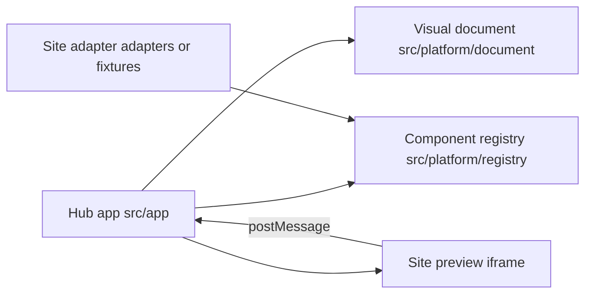

# Builder architecture

The hub edits a visual document. It does not import a site’s page components. Preview is an iframe. The hub and the site talk with `postMessage`.

Each box is a directory, not a website-specific switch in the hub. Discovery walks `adapters/` and `fixtures/` for an `adapter.ts`. Harbor lives in `fixtures/harbor`. Quantum Age lives in `adapters/quantum-age`.
